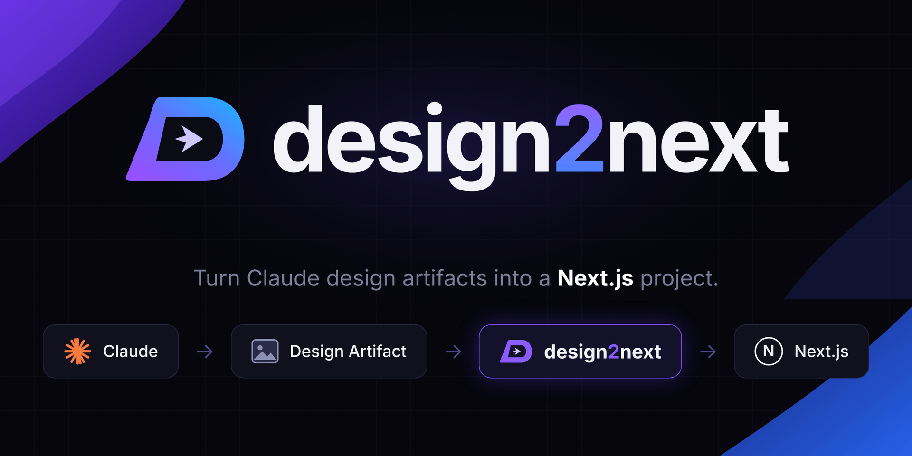

<div align="center">



# **design2next**

### Turn any design artifact into an opinionated Next.js project.

Hand your coding agent an HTML/CSS design (from tools like Claude Design, Open Design and others), a Figma file or a screenshot. It comes back with a structured, production-minded Next.js codebase that follows the design.

[](https://nextjs.org)
[](LICENCE)
[](skills/design-to-next/SKILL.md)

</div>

---

## What it is

**design2next** is a skill for AI coding agents. It's a set of instructions, playbooks and check scripts that tells the agent:

- **how to read a design**: exact values from HTML/CSS, estimates from screenshots
- **which stack to use**: always the same, so every project looks familiar
- **where every file goes**: a different structure for a landing page, a webshop and an app
- **what to check before calling it done**: responsive, accessible, typed, linted, built

It's **opinionated about how** things are built and **lean about what** gets built. A database, auth, payments, a CMS or translations are only added when the design or you ask for them.

It uses the standard `SKILL.md` format, so it works with Claude Code and with any other agent that supports skills.

## How it works

**Design → Read → Structure → Build → Verify**

1. **Design**: you give an HTML/CSS export, a Figma file or a screenshot.
2. **Read**: the agent pulls out tokens, fonts, copy and sections.
3. **Structure**: it picks the folder layout for a landing page, a shop or an app.
4. **Build**: tokens first, then UI components, then pages.
5. **Verify**: it checks three screen sizes, runs `check.sh` and builds the project.

> **Default is `check` mode:** the agent builds the first slice (setup, tokens, fonts, hero), shows you screenshots and **waits for your OK** before building the rest. Use `auto` to go straight through; it lists every assumption at the end.

## Design inputs

| Input                                                                                        | How it's used                                                                                                                                            |
| -------------------------------------------------------------------------------------------- | -------------------------------------------------------------------------------------------------------------------------------------------------------- |
| **HTML/CSS artifact or export** (main input): Claude Design, Open Design, any tool or folder | Reads markup, styles, fonts, assets and copy. **Exact values**. Markup is never copied as-is: repeated patterns become components, values become tokens. |
| **Figma**                                                                                    | Uses Figma tooling if your agent has it; otherwise asks for an export or the missing values.                                                             |
| **Screenshot, image or PDF**                                                                 | Estimates values and tells you which ones are estimates.                                                                                                 |

The design is the source of truth. The agent doesn't "improve" it: odd spacing or low contrast is built as designed and listed for you at the end.

## The stack

Always:

| Area           | What we use                                                        |
| -------------- | ------------------------------------------------------------------ |
| Framework      | **Next.js** (latest, App Router, Cache Components)                 |
| Language       | **TypeScript** (strict)                                            |
| Styling        | **Tailwind CSS v4**, design tokens as CSS variables                |
| Components     | Own UI components, **cva** for variants, `cn()` for classes        |
| Fonts & images | `next/font` (Google Fonts self-hosted), `next/image` with **WebP** |
| Forms          | **react-hook-form** + **Zod**, Server Actions                      |
| Quality        | **ESLint** + **Prettier**, typecheck, `check.sh`                   |

Only when the project needs it:

| Need         | What we use                                                                                 |
| ------------ | ------------------------------------------------------------------------------------------- |
| Database     | **Drizzle ORM**, PostgreSQL by default (MySQL, SQLite too), local **Docker** or your own DB |
| Auth         | **Better Auth**                                                                             |
| Payments     | **Stripe**                                                                                  |
| CMS          | **Payload** (blogs, pages, shop products)                                                   |
| Icons        | **lucide-react** by default (you can pick another set)                                      |
| Animation    | CSS first, **motion** only where CSS can't                                                  |
| Translations | Native Next.js dictionaries (+ Payload localization for CMS content)                        |
| Dark mode    | **next-themes**                                                                             |
| SEO          | Metadata API, sitemap, robots, JSON-LD with **schema-dts**                                  |
| Cookies (EU) | **Cookiebot** when a consent banner is needed                                               |
| Email        | Your choice (Resend, Postmark, Brevo...); the agent asks                                    |

## Project types

The type decides the folder structure. Pass it, or let the agent work it out from the design.

| Type      | For                             | Structure                                                                                                                  |
| --------- | ------------------------------- | -------------------------------------------------------------------------------------------------------------------------- |
| `landing` | Marketing site, portfolio, blog | Pages made of `components/sections/`, one Server Action per form                                                           |
| `shop`    | Webshop                         | **Feature-first**: `features/<domain>/` with its queries, actions, schemas and components. Cached catalog, Stripe checkout |
| `app`     | SaaS, dashboard, admin          | Same feature-first layout, plus a shared session helper, an action helper and central cache tags                           |

Every type: no `src/`, `app/` only holds routes, and nothing gets scaffolded that the project doesn't use.

## Get started

### Install

**With the skills CLI** (recommended, works with Claude Code, Cursor, Codex and other agents):

```bash
npx skills add Ablasko32/design2next
```

It asks which agents to install for and puts the skill where each one looks for it.

**As a Claude Code plugin** (Claude Code 2.1.275+):

```text
/plugin marketplace add Ablasko32/design2next
/plugin install design-to-next@design-to-next
```

Plugin updates arrive through the marketplace.

**Or copy it by hand** into any project:

```bash
git clone https://github.com/Ablasko32/design2next
mkdir -p /path/to/your-project/.claude/skills
cp -R design2next/skills/design-to-next /path/to/your-project/.claude/skills/
```

For other agents, put `skills/design-to-next/` wherever your agent loads skills from.

### Use

```text
/design-to-next [auto|check] [landing|shop|app] <design> [extra context...]
```

As a plugin, the command is `/design-to-next:design-to-next`.

- **`<design>`**: an artifact link, a local `.html` / image / PDF, or a folder with an HTML/CSS export
- **`check`** (default): builds setup, tokens, fonts and the hero first, shows you screenshots and **waits for your OK**. Catches wrong fonts or colors early.
- **`auto`**: builds everything in one go, picks sensible defaults and lists every assumption at the end
- **Extra context**: anything after the design, in plain words (pages, features, services)

```text
/design-to-next https://claude.ai/artifact/…
/design-to-next auto ./design-export
/design-to-next shop ./shop.html products from a CMS, guest checkout
/design-to-next app ./dashboard.html team accounts, projects CRUD, Resend for email
```

Or just ask: _"Use design2next to turn this design into a Next.js landing page. Show me what you found first."_

## Scripts

Two helpers ship with the skill. The agent runs them from your project root, and you can run them too. The path below is for a project install in `.claude/skills/`; use your own skill folder if you installed it elsewhere.

| Script                                                     | What it does                                                                                                                                                                                                                                                      |
| ---------------------------------------------------------- | ----------------------------------------------------------------------------------------------------------------------------------------------------------------------------------------------------------------------------------------------------------------- |
| [`check.sh`](skills/design-to-next/scripts/check.sh)       | Checks structure, tokens, server/client boundaries, images, env, database, CMS, SEO basics, auth and Stripe safety, image hosts and security headers. Then runs typecheck, lint and format check (`--build` also builds). Exits `1` on errors, so it works in CI. |
| [`to-webp.mjs`](skills/design-to-next/scripts/to-webp.mjs) | Converts PNG / JPG / GIF / TIFF in `assets/images` to WebP (`--replace` removes the originals).                                                                                                                                                                   |

```bash
bash .claude/skills/design-to-next/scripts/check.sh --build
node .claude/skills/design-to-next/scripts/to-webp.mjs assets/images --replace
```

`check.sh` is a fast heuristic, not a proof: it catches the common mistakes. Matching the design and the quality of the content are still checked by eye.

## Playbooks

The agent only reads the ones a project needs.

**Always**

- [`design-input.md`](skills/design-to-next/references/design-input.md): reading HTML/CSS exports, Figma and screenshots
- [`tokens.md`](skills/design-to-next/references/tokens.md): turning design values into tokens

**Structure** (one per project)

- [`structure-landing.md`](skills/design-to-next/references/structure-landing.md): landing pages, portfolios, blogs
- [`structure-app.md`](skills/design-to-next/references/structure-app.md): webshops and apps, feature-first

**When needed**

- [`database.md`](skills/design-to-next/references/database.md): picking a database, local Docker or your own connection
- [`auth.md`](skills/design-to-next/references/auth.md): Better Auth
- [`payments.md`](skills/design-to-next/references/payments.md): Stripe
- [`cms.md`](skills/design-to-next/references/cms.md): Payload CMS
- [`i18n.md`](skills/design-to-next/references/i18n.md): translations, including CMS content
- [`seo.md`](skills/design-to-next/references/seo.md): SEO for public pages
- [`dark-mode.md`](skills/design-to-next/references/dark-mode.md): dark mode
- [`legal-eu.md`](skills/design-to-next/references/legal-eu.md): GDPR, cookies and legal pages

## License

[MIT](LICENCE)
